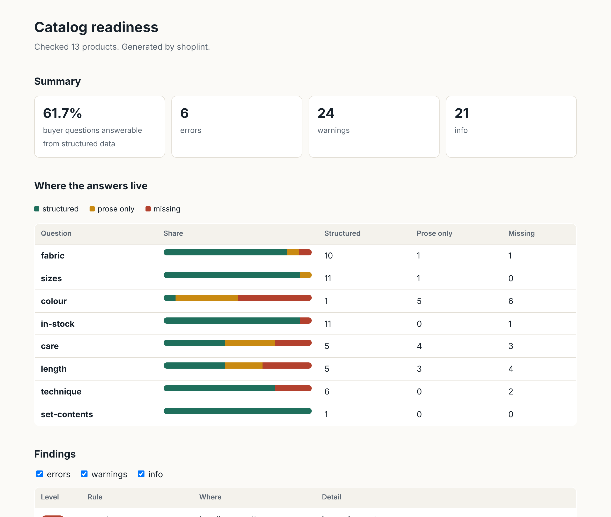

# agentready

Checks a Shopify product export against what AI shopping agents and product feeds
actually read, and tells you which buyer questions your catalog can't answer.

```
$ agentready audit products_export.csv
13 products checked against: acp, gmc, hygiene
6 errors, 24 warnings, 21 info
...
Buyer questions answerable from structured data: 50/81 (61.7%)
```

**Live sample report:** https://yashere69.github.io/agentready/ (built by CI from the
fictional catalog in `examples/`)



## Background

Shopify now syndicates eligible catalogs to AI assistants by default (Agentic Storefronts,
Winter '26 Edition). OpenAI's product feed spec for agentic commerce lists nine required
fields per item, and Google's feeds have their own rules. A shopping agent answering
"is this kurta cotton, and do you have it in XL?" works from these structured fields
first. A fabric mentioned only in a paragraph of marketing copy may or may not get used.

I help run a small ethnic-wear store on Shopify and wanted a way to see the catalog the way
a feed or an agent sees it: field by field, not as the product page a person reads.

## Install and run

```bash
pip install git+https://github.com/yashere69/agentready
agentready audit products_export.csv --html report.html --findings-csv fixes.csv
agentready export products_export.csv --store-url https://yourstore.com --seller "Your Store" -o feed.jsonl
```

Get the CSV from Shopify admin → Products → Export → "All products", "CSV for Excel,
Numbers, or other spreadsheet programs". Nothing leaves your machine. A file that has been
opened and re-saved in Excel on Windows (cp1252 rather than UTF-8) is read too.

`--findings-csv` gives one row per problem (level, rule, product, detail, why), which is
the form most stores actually work through: sort by product, fix, re-export, re-run. On a
3,000-product, 12,000-variant export the audit takes about a third of a second.

## What it checks

Rules live in YAML packs. Each pack names the document it was written against and the
date that document was read, and the report prints both:

| Pack | Written against | Rules |
|---|---|---|
| `acp` | [OpenAI Agentic Commerce product feed, Stable](https://developers.openai.com/commerce/specs/file-upload/products) | required fields, title ≤150, description ≤5,000, stable unique item ids, positive prices, knowable availability; size/colour/material as info |
| `gmc` | [Google Merchant Center product data spec](https://support.google.com/merchants/answer/7052112) (apparel subset) | length limits, image, colour and size for apparel, one image per colour variant |
| `hygiene` | no spec; common catalog problems | missing alt text, mixed size systems ("S, M, 38, 40"), option values differing only in case, compare-at ≤ price, very thin descriptions, active products with nothing to buy |

A rule is a few lines:

```yaml
- id: hygiene.size-mix
  level: warning
  check: size_system_consistent
  message: One product mixes size systems, so "is M the same as 38?" has no answer.
```

`check` names a function in `src/agentready/checks.py`. You can add a pack for your own
store's conventions without touching Python, as long as it reuses existing checks:
`agentready audit export.csv --pack my-rules.yaml`.

## The question probe

The probe asks each product the questions buyers actually send in DMs and WhatsApp: what
fabric, which sizes, what colour, in stock, how to wash, how long, is it hand block printed,
what's in the set. It sorts each answer into one of three buckets:

- **structured**: an option, metafield, tag or inventory field holds it
- **prose-only**: only the description mentions it
- **missing**: nowhere

It is not an LLM. It answers "is this fact present as data?", which is what feeds reward.

The questions are YAML. The built-in set
([`questions/apparel-india.yaml`](src/agentready/questions/apparel-india.yaml)) is for
Indian ethnic wear. A store selling kettles or books writes its own (warranty, voltage,
edition) and passes `--questions my-questions.yaml`. Each question says where a structured
answer may live (option names, metafield keys, a tag pattern, inventory) and what to look
for in the description.
Because it's deterministic, before/after numbers can be compared.
[results/before-after.md](results/before-after.md) has the sample catalog before and after
fixing (`python tools/before_after.py` regenerates it):

| | Before | After |
|---|---|---|
| Errors | 6 | 0 |
| Warnings | 24 | 1 |
| Buyer questions answerable from structured data | 50/81 (61.7%) | 77/81 (95.1%) |

The catalog is made up, and its defects were put there on purpose, so these numbers show
what the tool reports. They say nothing about how real stores score, and nothing about
ranking in any assistant.

## Feed export

`agentready export` writes one JSON line per variant in the ACP shape: `item_id` from SKU,
`group_id`, `listing_has_variations` and `variant_dict` for multi-variant products, `size`,
`color` and `material` when they exist as data, and price as `"1890.00 INR"`.

It doesn't invent values. A variant with no SKU, image, description, brand or valid price
is skipped and reported on stderr. Two limits come from the CSV itself:

- The export has no variant ids, so `url` points at the product page, not the variant.
- Availability is only `in_stock`/`out_of_stock` when inventory is tracked, otherwise
  `unknown`.

## Design choices

- **Packs are dated.** These specs changed several times in 2025–26 and sources disagree
  on required field counts. A finding is only as good as the spec version behind it.
- **Drafts are skipped** (they aren't syndicated), except by the rule that flags active
  products with nothing to buy.
- **Size systems are classified, not normalised.** agentready can tell you "S, M, 38, 40" is
  a mix. Mapping 38 to M is the store's call, so it doesn't guess.
- **The sample catalog has reviewed expectations.** `eval/expected.yaml` lists every
  error and warning that should fire on `examples/indigo-loom.csv`, and a test fails if a
  rule change adds or drops one.

More in [docs/architecture.md](docs/architecture.md).

## Limits

- Only Shopify's CSV export. There's no Admin API sync yet.
- Images aren't analysed. A colour variant pointing at the wrong photo won't be caught.
- The built-in question set is tuned for Indian ethnic wear. Other categories need their
  own YAML; nothing else changes.
- Google's UCP and Merchant Center have more rules than the apparel subset here.

## Development

```bash
pip install -e ".[dev]"
ruff check . && mypy src && pytest
```

MIT licensed. The `examples/` catalog is fictional; "Indigo Loom" is not a real store.
