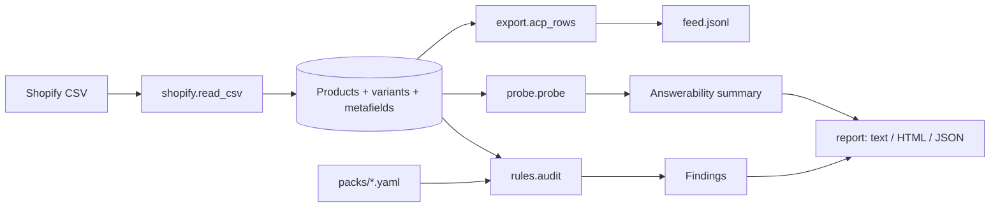

# shoplint internals

## Reading the export

Shopify writes one row per variant, plus extra rows for images beyond the variant count.
Only the first row of a product has product-level columns, and later rows repeat just
the `Handle`. `read_csv` groups rows by handle, collects images from any row that has
`Image Src`, and creates a variant only from rows that carry option values or a price.

Metafield columns look like `Fabric (product.metafields.custom.fabric)`. They're
detected by that suffix, so any metafield the store defines is picked up without
configuration. `Product.metafield("fabric", "material")` matches on the key and ignores
the namespace: one store uses `custom.fabric`, another `details.material`.

## Checks and packs

A check is a function `(product, params, context) -> iterator of (target, detail)`,
registered by name. `Context` holds catalog-wide facts: SKU counts for duplicate detection,
and every product for "dominant size system" comparisons. Packs bind checks to rule ids,
levels and messages.

The split keeps the spec-specific part (what's required, what the limits are, which
document it came from) in data. When OpenAI changes a limit, the edit is one line of YAML
with a new `checked:` date.

## Why the probe isn't an LLM

An LLM reading the description could answer more questions, and that's the trap. Whether
an agent answers from prose depends on the agent. Whether the fact exists as a field is
something you can check and fix. The probe measures the second, deterministically, so a
store can track it over time.

## Report

The HTML report is one file with no external assets: inline CSS and a few lines of
JavaScript for the level filter. Tables scroll horizontally on small screens, the bars
have text equivalents in `aria-label`, and colours aren't the only signal (counts are in
the table too). CI publishes the sample report to GitHub Pages on every push to `main`.
